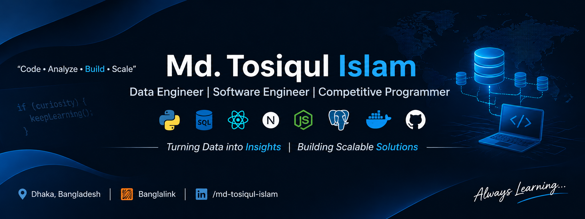

# Hi 👋, I'm Md. Tosiqul Islam

### Data Engineer | Software Engineer | Competitive Programmer

I'm a Data Engineer at **Banglalink**, working on Data Warehouse System (DWS) migration, with a background in full-stack software development and competitive programming.

I enjoy solving complex problems, building scalable applications, working with databases, and exploring data engineering technologies.

### 💼 Professional Experience

- **Data Engineer — Banglalink** (November 2026 – Present)
  - Contributing to DWS migration and data engineering workflows.
  - Working with SQL, data processing, and migration tasks.

- **Junior Software Engineer — TechOptions** (August 2025 – October 2026)
  - Developed and maintained enterprise LMS platforms.
  - Improved application performance using TanStack Query and caching strategies.
  - Developed backend APIs using FastAPI and PostgreSQL.
  - Worked with observability tools including OpenTelemetry, Prometheus, Grafana, and Jaeger.

- **Frontend Developer — Jeda.ai** (October 2024 – July 2025)
  - Developed interactive AI workspace features.
  - Worked with React, Redux, and Fabric.js.
  - Improved canvas performance and editing workflows.

### 🛠️ Technical Skills

- **Languages:** JavaScript, TypeScript, Python, C, C++, Java, SQL
- **Frontend:** React.js, Next.js, Tailwind CSS, Redux, TanStack Query, Shadcn UI
- **Backend:** Node.js, Express.js, FastAPI
- **Databases:** PostgreSQL, MongoDB
- **Data Engineering:** SQL, Data Warehousing, Data Migration
- **Cloud & DevOps:** Docker, AWS Basics, GitHub Actions, CI/CD
- **Observability:** OpenTelemetry, Prometheus, Grafana, Jaeger
- **Tools:** Git, GitHub, VS Code, WebStorm

### 🚀 Featured Projects

**FocusTube**
- YouTube utility browser extension with 280+ organic installs.
- Built using React.js, Vite, Tailwind CSS, and Chrome Extension APIs.

**Next Career**
- Job platform connecting candidates and recruiters.
- Includes job applications, application tracking, recruitment workflows, and interview scheduling.
- Built using React.js, Node.js, Express.js, MongoDB, Firebase, and WebSocket.

### 🏆 Competitive Programming

- Solved **1,000+ DSA problems** across Codeforces, CodeChef, and LeetCode.
- Participated in **200+ online programming contests**.

**Profiles:**
- [Codeforces](https://codeforces.com/profile/Tosiqul_Islam)
- [LeetCode](https://leetcode.com/u/Tosiqul_Islam/)

### 📫 Connect With Me

- **Email:** sopon.tosiq@gmail.com
- **LinkedIn:** [Md. Tosiqul Islam](https://www.linkedin.com/in/md-tosiqul-islam)
- **GitHub:** [Tosiqul-Islam-Sopon](https://github.com/Tosiqul-Islam-Sopon)
